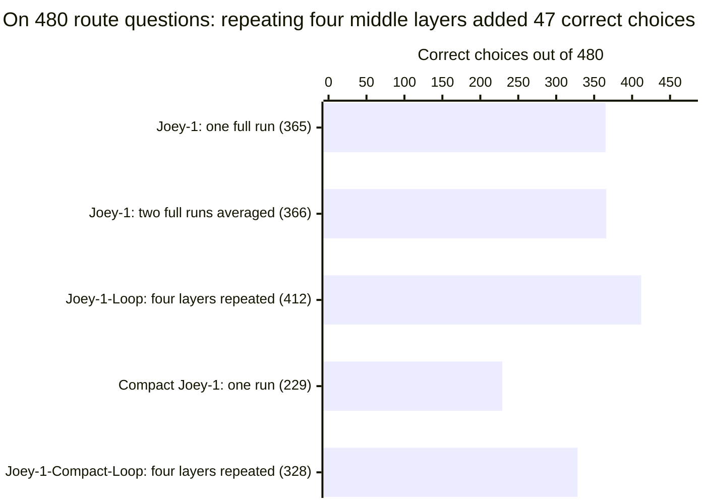
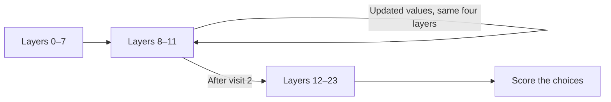
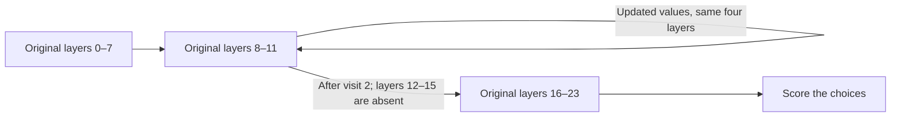

# Joey-1-Loop and Joey-1-Compact-Loop

**Joey-1-Loop** and **Joey-1-Compact-Loop** are independent layer-reuse variants of [Joey-1](https://huggingface.co/baselabs/joey-1). This repository tests whether running four existing middle layers twice helps an already-trained decision model choose more accurately without retraining ([scope](#strengths-and-limitations)).

Base Labs at Baseten built `Joey-1` as a 2B-parameter **decision model**: given context, a question, and named options (such as *billing*, *login*, or *card replacement*), it returns a winning choice and a probability per option. On 480 held-out routing decisions, looping lifted `Joey-1` accuracy from **76.0%** to **85.8%**.

Neither variant is an official Base Labs or Baseten release. `Joey-1-Loop` keeps all 24 text layers, while `Joey-1-Compact-Loop` deletes four other layers (**8.4% smaller** file). Both use **direct (`naive`) feedback**: visit two feeds the repeated block's updated hidden values straight back in, with no added learned cross-pass gate.

[Thinking Machines' Inkling 2 Mini](https://thinkingmachines.ai/news/inkling-2-mini/) and the [Hugging Face blog post](https://huggingface.co/blog/inkling2mini) inspired this experiment without replicating that architecture. Inkling 2 Mini was trained to loop: layers `0–5` run once, each core visit starts from that same output, and later visits mix a learned message from the immediately preceding visit.

## Releases and inference runtime

Each standalone release pairs the **weights** (`model.safetensors`, the model's learned numbers) with **`run_joey.py`** ([source](scripts/hub/run_joey.py)), a custom text-only Python inference path built on the patched OneJev (`qev`) decision engine plus Hugging Face Transformers and PyTorch, evaluated with CUDA on NVIDIA A100 GPUs ([setup](scripts/hub/USAGE.md), [runtime notes](docs/native-runtime.md)). A generic `transformers` load of `model.safetensors` alone runs each stored layer once and does **not** activate recurrence; neither `vLLM`, `SGLang`, `llama.cpp`, nor `MLX` was used or validated for these runs.

| Release | Contents and use case |
| --- | --- |
| **[Joey-1-Loop model card](docs/model-cards/joey-1-loop.md)** · [Find the weights on Hugging Face](https://huggingface.co/models?search=Joey-1-Loop) | Unchanged `Joey-1` weights plus `run_joey.py`. Highest routing accuracy tested in this study. |
| **[Joey-1-Compact-Loop model card](docs/model-cards/joey-1-compact-loop.md)** · [Find the weights on Hugging Face](https://huggingface.co/models?search=Joey-1-Compact-Loop) | Standalone **8.4% smaller** file (four layers removed, four middle layers run twice) for studying size versus accuracy. |

## What did the models get right?

Each question listed directed connections between stations, named a destination, and asked which starting station reaches it (**480 decisions across 60 unseen graphs**).

<!-- Edit the shared table here, then run python3 scripts/hub/sync_routing_table.py --write. -->
<!-- routing-results:begin -->

| Model / run | What ran | Layer visits | Correct of 480 | Accuracy | Net vs. one pass on the same weights |
| --- | --- | ---: | ---: | ---: | ---: |
| `Joey-1` (one pass, loop off) | All 24 layers once | 24 | 365 | 76.0% | Baseline |
| `Joey-1` (two full runs, loop off) | Run all 24 layers twice independently; reverse the choices in run two and average each choice's probabilities | 48 | 366 | 76.25% | +1 |
| **`Joey-1-Loop` (loop on)** | Same 24 layers; repeat only `8–11` before one decision | 28 | **412** | **85.8%** | **+47** |
| `Joey-1-Compact-Loop` (one pass, loop off) | All 20 retained layers once | 20 | 229 | 47.7% | Baseline |
| **`Joey-1-Compact-Loop` (loop on)** | Same 20-layer file; repeat only `8–11` before one decision | 24 | **328** | **68.3%** | **+99** |

<!-- routing-results:end -->

On full `Joey-1`, the loop fixed **48** one-pass mistakes and spoiled **1** (`365` to `412`). The **loop-off** row is a baseline comparator on the same 20-layer file, not a third release; turning the loop on fixed **105** mistakes and spoiled **6**, a net gain of **99** (`229` to `328`) that still stayed below full `Joey-1` (`365`).

**Was it just extra compute?** Running original `Joey-1` twice (once in original choice order and once reversed) and averaging each choice's probabilities got **366/480** vs. **412/480** for `Joey-1-Loop` at nearly the same CUDA time. Separately, across the **67** questions missed by both original one-pass `Joey-1` and `Joey-1-Loop`, `Joey-1-Loop` gave higher probability to its wrong choice on **25 of 67**.

## How Joey-1-Loop works

Each **layer** updates a numeric representation of the prompt and options. Stock `Joey-1` runs 24 text layers once (`0`–`23`). **`Joey-1-Loop` keeps all 24.** If `h` is the representation leaving layer `7` and `B` is the four-layer block `8–11`, stock `Joey-1` runs `B(h)` while `Joey-1-Loop` runs **`B(B(h))`**: the output of layers `8–11` becomes the next input to those same four layers (`run_two_pass` in [`scripts/hub/run_joey.py`](scripts/hub/run_joey.py); [`loop.py`](src/joey_research/loop.py), [`native.py`](src/joey_research/native.py)). Pass two does not resend the prompt, decode a first guess, carry over temporary state from visit one, or add a new gate; layers `12–23` then run once and score the choices.

Zero-based schedule: **`0–7 → 8–11 → 8–11 → 12–23`** (**24 stored layers, 28 visits**).

**Direct loop vs. Inkling 2 Mini (and two code terms):** Both released checkpoints use the `k=2`, `naive` schedule, rather than the damped or multi-stage rules evaluated during development; in [`loop.py`](src/joey_research/loop.py), `naive` names only that simple `B(B(h))` connection, not `Joey-1`'s pretrained layers. By contrast, [Inkling 2 Mini](https://thinkingmachines.ai/news/inkling-2-mini/) ([Hugging Face post](https://huggingface.co/blog/inkling2mini)) runs its 12 middle layers (`6–17`) three times (`6 + 3×12 + 6`, 48 visits from 24 stored layers): each core visit starts from the **same output** of its first six layers (`0–5`), and later visits mix in a learned read from the prior visit's two middle blocks. In the runner code, **`coda`** simply names the original post-loop final layers (`12–23` in full, source `16–23` in compact), followed by normal final normalization and one scoring head, not an extra learned module.

## How Joey-1-Compact-Loop works

**`Joey-1-Compact-Loop` removes original layers `12–15` from `model.safetensors`**, leaving 20 standalone layers (`0–19`, where original `16–23` become `12–19`). Using the same `k=2`, `method="naive"` loop on `[8, 12)`, `run_joey.py` runs `8–11` twice, then finishes through kept original `16–23`, final normalization, and one option readout.

Zero-based schedule: **`0–7 → 8–11 → 8–11 → 16–23`** in original IDs, or **`0–7 → 8–11 → 8–11 → 12–19`** in the file (**20 stored layers, 24 visits**). Saving **8.4%** on disk did not save time at equal visits: timed one input at a time on two A100 GPUs, `Joey-1-Compact-Loop` used **3.4% more CUDA time** than 24-layer `Joey-1` run once in stages.

## Try it or dig deeper

Download either full Hugging Face repository so `run_joey.py` sits beside `model.safetensors`. On CPU (Python 3.10+), run `python run_joey.py --verify-only` to check hashes and the schedule; after the [Linux/CUDA setup](scripts/hub/USAGE.md), run `python run_joey.py` to score a sample ticket. Repository unit tests run without weights via `PYTHONPATH=src:. python3 -B -m unittest discover -s tests -q`.

- **Technical details:** [Loop engine](docs/loop.md) · [Native runtime](docs/native-runtime.md) · [Compact exporter](docs/compact.md) · [Compact runtime](docs/native-compact.md) · [Scoring & confidence](docs/evaluation.md) · [GPU timing](docs/trace-cost.md) · [BANKING77 check](docs/public-development.md)

## Strengths and limitations

### What the benchmark supports

- **The same weights made better route choices.** The four layers were selected before the final test on 60 new maps. Repeating them took full `Joey-1` from 365 to 412 correct answers out of 480 (76.0% to 85.8%), without retraining.
- **Two ordinary runs did not match the loop.** Running `Joey-1` twice, reversing the choices in one run and averaging the scores, got 366 of 480 right at about the same GPU time as `Joey-1-Loop`.
- **The smaller model recovered some accuracy.** On the same 20-layer file, accuracy rose from 47.7% with the loop off to 68.3% with it on. The original 24-layer `Joey-1` still did better at 76.0%.

### Where the evidence stops

- **One synthetic task had an independent final test.** Inventory and BANKING77 were development checks. On 512 BANKING77 training messages, the full model got 477 right without the loop and 478 with it.
- **Some wrong answers became more confident.** On 25 of the 67 questions both full-model runs missed, `Joey-1-Loop` assigned a higher probability to its wrong choice.
- **Transfer remains untested.** The routing result supports trying loops on other decision tasks; it does not establish a gain for other model families or production workloads.
