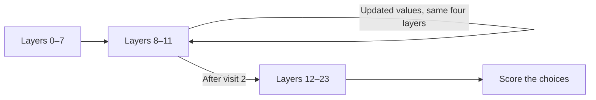
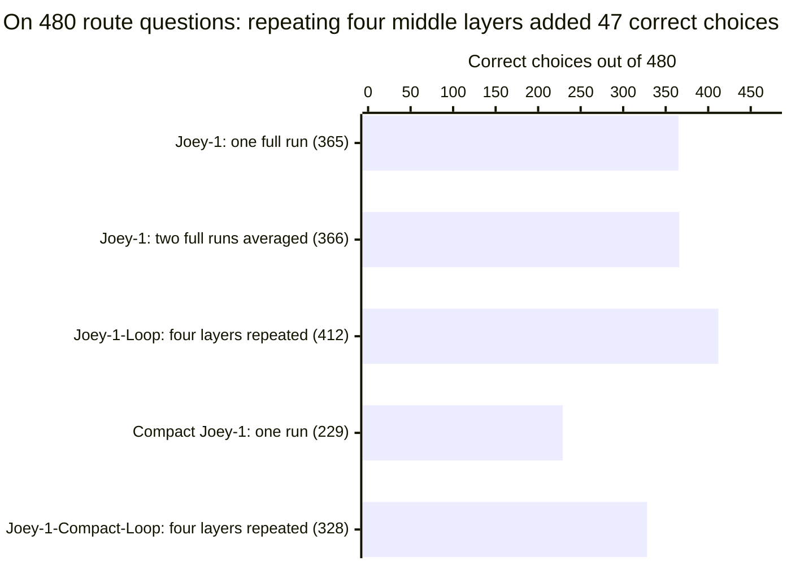

# Joey-1-Loop

**Joey-1-Loop** is an independent layer-reuse variant of [Joey-1](https://huggingface.co/baselabs/joey-1), the 2B-parameter **decision model** Base Labs at Baseten post-trained from Qwen3.5-2B. It is not an official Base Labs or Baseten release. Instead of writing chat replies word by word, a decision model reads context, a question, and named options, returning a winning choice and a probability per option. With zero extra training, `Joey-1-Loop` uses **direct (naive) feedback**: it runs the same four frozen middle layers on their own updated output a second time, with no new learned cross-pass gate.

By contrast, [Thinking Machines' Inkling 2 Mini](https://thinkingmachines.ai/news/inkling-2-mini/) and [Hugging Face's Inkling 2 Mini explainer](https://huggingface.co/blog/inkling2mini) describe a trained loop that inspired this variant, not a replicated architecture or accuracy comparison. Each **layer** is a processing step and each **weight** is a learned number. In Inkling 2 Mini, the first six layers (`0–5`) run once, and each of the three visits to its 12 middle layers starts from that same initial output. On visits 2 and 3, learned attention and gates mix a message from the immediately previous visit, without rerunning the opening layers or reading all prior passes.

The evaluation tests what direct feedback alone does on unmodified `Joey-1` weights. Repeating those four middle layers lifted held-out routing accuracy from **365/480 (76.0%)** to **412/480 (85.8%)**.

## How Joey-1-Loop works



**Inference runtime:** The tested and released path is a custom text-only Python inference runner using the patched OneJev/`qev` `DecisionEngine` and Hugging Face Transformers Qwen3.5 layers on PyTorch with CUDA (evaluated on NVIDIA A100 GPUs), with `run_joey.py` as its included entry point. Loading the checkpoint in stock `transformers` alone runs a single pass without enabling the loop, and these experiments were not benchmarked or validated in vLLM, SGLang, `llama.cpp`, or MLX.

- **`model.safetensors`** stores the learned weights and is byte-for-byte identical to [Base Labs' `baselabs/joey-1` checkpoint](https://huggingface.co/baselabs/joey-1/tree/db5c2a631f2da93c4173378438d8246966e25159).
- **`run_joey.py`** executes the two-pass schedule (`k=2`, `method="naive"` on slice `[8, 12)`, zero-based layers `8–11` of `Joey-1`'s **24 stored text layers** `0–23`). One forward pass splits into `prelude`, `block`, and `coda`. `Prelude` runs `0–7` once. `Block` runs `8–11` twice, feeding pass one's numeric output straight into pass two as input. `Coda` is the existing layers after the loop (`12–23`), followed by normal normalization and one choice score per option, not an extra module or pass.

- **Zero-based schedule:** `0–7 → 8–11 → 8–11 → 12–23` (**24 stored text layers, 28 layer visits**)

Layers `8–11` have three pretrained causal `GatedDeltaNet` layers and one block-masked full-attention layer; `Joey-1`'s original internal gates remain intact, with no learned cross-pass gate. The full model never restarts, repeats the prompt, or feeds back a first answer. Prompt tokens, positions, masks, and weights stay fixed, while sequence cache and attention, short-convolution, and recurrent state start fresh each visit.

## Held-out routing results and confidence

All five schedules answered the same **480 synthetic routing questions across 60 new graphs**. Each question asked which candidate station could reach a destination. The first three rows use the original 24-layer weights; the last two use the same compact 20-layer file.

<!-- routing-results:begin -->

| Model / run | What ran | Layer visits | Correct of 480 | Accuracy | Net vs. one pass on the same weights |
| --- | --- | ---: | ---: | ---: | ---: |
| `Joey-1` (one pass, loop off) | All 24 layers once | 24 | 365 | 76.0% | Baseline |
| `Joey-1` (two full runs, loop off) | Run all 24 layers twice independently; reverse the choices in run two and average each choice's probabilities | 48 | 366 | 76.25% | +1 |
| **`Joey-1-Loop` (loop on)** | Same 24 layers; repeat only `8–11` before one decision | 28 | **412** | **85.8%** | **+47** |
| `Joey-1-Compact-Loop` (one pass, loop off) | All 20 retained layers once | 20 | 229 | 47.7% | Baseline |
| **`Joey-1-Compact-Loop` (loop on)** | Same 20-layer file; repeat only `8–11` before one decision | 24 | **328** | **68.3%** | **+99** |

<!-- routing-results:end -->



Two whole-model runs added **one** correct answer over the 365-answer baseline. Repeating only layers `8–11` added **47**.

Repeating `8–11` fixed **48** one-pass errors and added **1** new error (**+9.8 percentage points**; paired whole-graph 95% CI **+7.1 to +12.3 points** over 2,000 graph resamples). A compute-matched order control ran stock `Joey-1` twice (original and reversed option order, averaging probabilities) within **2%** of `Joey-1-Loop` GPU time and scored **366/480**, versus **412/480**.

For full `Joey-1`, raw Brier score (squared error summed over all option probabilities; lower is better) improved from **0.3291** with the loop off to **0.2162** with it on. Even so, wrong-choice confidence rose on **25 of the 67** questions both schedules missed.

Synthetic inventory tasks and **512 BANKING77 training complaints** (`477/512` for `Joey-1` vs. `478/512` for `Joey-1-Loop`) were separate development checks, not multiple confirmatory datasets or official held-out BANKING77 or Decision Index tests.

## Quickstart and usage

Download the complete [Joey-1-Loop release on Hugging Face](https://huggingface.co/models?search=Joey-1-Loop) so `run_joey.py` and the loop metadata sit alongside `model.safetensors`. On any CPU machine with Python 3.10+, verify the snapshot checksums, tokenizer, and `0–7 → 8–11 → 8–11 → 12–23` schedule from the downloaded directory:

```bash
python run_joey.py --verify-only
```

Running actual decisions requires Linux with an NVIDIA CUDA GPU; follow the [Linux/CUDA setup and example request](../../scripts/hub/USAGE.md) to install the pinned dependencies. Then run the built-in support-ticket example or pass a JSON decision request:

```bash
python run_joey.py
python run_joey.py --request request.json
```

The runner outputs the winning `choice` and per-option `probabilities` for each question. This snapshot is self-contained (no separate `Joey-1` download is required), and only text decisions were tested.

## License and attribution

Base Labs at Baseten post-trained [`baselabs/joey-1`](https://huggingface.co/baselabs/joey-1/tree/db5c2a631f2da93c4173378438d8246966e25159) (`db5c2a631f2da93c4173378438d8246966e25159`) from Alibaba Cloud's [Qwen3.5-2B](https://huggingface.co/Qwen/Qwen3.5-2B). Baseten's modifications use MIT and Qwen3.5-2B uses Apache-2.0; both licenses apply. The snapshot includes [LICENSE](https://huggingface.co/baselabs/joey-1/blob/db5c2a631f2da93c4173378438d8246966e25159/LICENSE), [NOTICE](https://huggingface.co/baselabs/joey-1/blob/db5c2a631f2da93c4173378438d8246966e25159/NOTICE), `LICENSE-APACHE-2.0`, and `THIRD_PARTY.md`.

## Strengths and limitations

On this held-out routing task, repeating four middle layers lifted an existing decision model from **76.0%** to **85.8%** accuracy without retraining. That gain is meaningful because a frozen schedule beat both one-pass `Joey-1` and a compute-matched control on identical weights and prompts. Whether untrained layer reuse helps across broader real-world datasets or other model families is not yet established.
